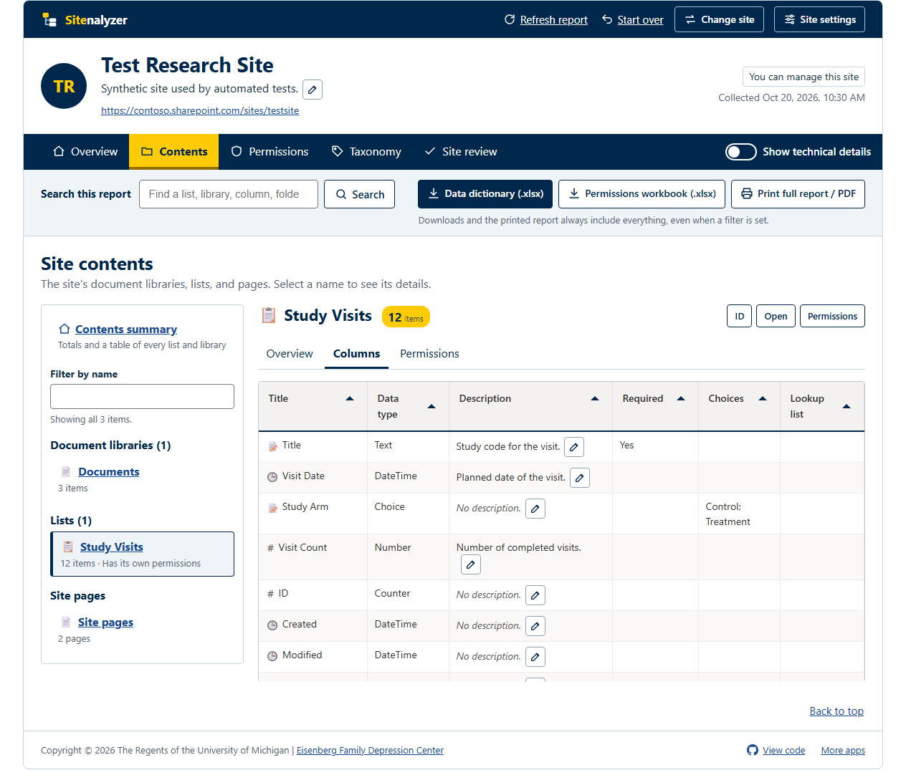

<!--
This file is part of Sitenalyzer
README.md - Main README file with overview, quick start guide and license information.
Author(s): Gabriel Mongefranco
Created: 2026-04-20
Last Modified: 2026-10-21
Summary: Provides an overview of the project, in Markdown format.
Notes: See README file for documentation and full license information.

Copyright © 2026 The Regents of the University of Michigan

This program is free software: you can redistribute it and/or modify
it under the terms of the GNU General Public License as published by
the Free Software Foundation, either version 3 of the License, or (at your option) any later version.
This program is distributed in the hope that it will be useful,
but WITHOUT ANY WARRANTY; without even the implied warranty of
MERCHANTABILITY or FITNESS FOR A PARTICULAR PURPOSE. See the
GNU General Public License for more details.
You should have received a copy of the GNU General Public License along
with this program. If not, see <https://www.gnu.org/licenses/>.

-->

# Sitenalyzer

## Description
Sitenalyzer is an open-source inventory and data dictionary tool for SharePoint Online. It runs on a page in your site and reports the site's lists, document libraries, columns, permissions, agents, and site skills. It can also save that report as an Excel data dictionary. It is designed for data stewards, research teams, SharePoint administrators, developers, security analysts, and data analysts.

With Sitenalyzer, you can:
+ Review every list and library, with its columns, descriptions, and item counts, every site page, and the agents and site skills saved on the site.
+ Check permissions for the site and for each list or library, including apps that have access.
+ See who can open what, by person or group, with the members of each SharePoint group, and check what one person can do.
+ Spot guests, organization-wide access, and sharing links that anyone can use, and find lists and libraries to review.
+ Save a data dictionary or a permissions workbook as an Excel file, or print the whole report or save it as a PDF.
+ Move between an Overview, Contents, Permissions, Taxonomy, and Site review, and search the whole report, with results grouped by kind.
+ Edit site, list, column, and term descriptions, if you own the site.
+ Turn on technical details to see internal names, and copy the site, list, and library IDs needed for Microsoft Graph and Microsoft Entra apps.
+ Hide values that look like personal information, such as phone numbers, on screen, in printouts, and in workbooks, until you choose to show them.

## Quick Start Guide
+ First, make sure the "Modern Script Editor" app is installed. If it isn't available, ask your site administrator to install it.
+ In your site's Site Assets library (Settings > Site contents > Site Assets), create two folders named `scripts` and `styles`.
+ Copy every file from [dist/SiteAssets/scripts/](dist/SiteAssets/scripts/) to your site's `SiteAssets/scripts` folder.
+ Copy every file from [dist/SiteAssets/styles/](dist/SiteAssets/styles/) to your site's `SiteAssets/styles` folder.
+ Go to your site's home page and create a new page from the Modern Script Editor template (Home > New > Page > Modern Script Editor). Use `sitenalyzer` for the page title, so the page address ends in `/SitePages/sitenalyzer.aspx`.
+ Select the "{ }" button under Edit HTML Code to open the code editor. Copy the contents of [dist/SitePages/sitenalyzer.html.txt](dist/SitePages/sitenalyzer.html.txt) and paste them into the code editor. Select Save in the code editor to close it, then select Save on the page to leave edit mode.
+ Refresh the page.
+ Enter a site address, or keep the current site's address in the box, and select **Extract site information**.
+ To save the data dictionary as a spreadsheet, select **Data dictionary (.xlsx)**. To save every permission, select **Permissions workbook (.xlsx)**.

To install a newer version, copy the files from `dist/SiteAssets` again and replace the old ones. You don't need to change the page.

## Documentation
+ **Complete documentation:** See the [`/docs`](./docs) folder in this repository: [installing and using Sitenalyzer](docs/usage.md), [troubleshooting](docs/troubleshooting.md), [architecture](docs/architecture.md), and [building and testing](docs/development.md).
+ **Overview for researchers and developers:** Visit the [Health Research Resource Library](https://michmed.org/efdc-kb) for a high-level summary, key features, and important assumptions.
+ **Project instructions for contributors and AI coding tools:** See [AGENTS.md](AGENTS.md) and the [skills index](SKILLS.md).

## Additional Resources
+ This script was created to facilitate the process for creating Microsoft Entra applications at Michigan Medicine. For more information, see "[How to Connect to SharePoint from Scripts, Workflows or Data Pipelines](https://teamdynamix.umich.edu/TDClient/210/DepressionCenter/KB/ArticleDet?ID=15245)" (UM login required).

## About the Team
The [Mobile Technologies Core](https://depressioncenter.org/mobiletech) provides investigators across the University of Michigan the support and guidance needed to utilize mobile technologies and digital mental health measures in their studies. Experienced faculty and staff offer hands-on consultative services to researchers throughout the University – regardless of specialty or research focus.

Learn more at: [https://depressioncenter.org/mobiletech](https://depressioncenter.org/mobiletech).

## Contact
To get in touch, contact the individual developers in the check-in history.

If you need assistance identifying a contact person, email the EFDC's Mobile Technologies Core at: efdc-mobiletech@umich.edu.

## Credits

### Authors:
+ [Gabriel Mongefranco](https://gabriel.mongefranco.com) [(@gabrielmongefranco)](https://github.com/gabrielmongefranco)

#### Contributors:
+ [Eisenberg Family Depression Center](https://depressioncenter.org) [(@DepressionCenter)](https://github.com/DepressionCenter)
+ [Jeremy Gluskin](https://www.linkedin.com/in/jeremy-gluskin-16980623/) ([@jerm-ops](https://github.com/jerm-ops))
+ [Shelley Boa](https://www.linkedin.com/in/shelleyboa/) [(@blondilox-ai)](https://github.com/blondilox-ai) - Program Manager, Internal Medicine / Pulmonology & Critical Care, Michigan Medicine.

#### This work is based in part on the following projects, libraries and/or studies:
+ [DataLaVista™](https://michmed.org/datalavista). A lightweight, client-side reporting and dashboard toolkit. This project re-uses some of the SharePoint connection functions.
+ [Modern Script Editor](https://github.com/pnp/sp-dev-fx-webparts/tree/main/samples/react-script-editor) - The PnP/SPFX delivery vehicle used to deploy this "Unit" into modern SharePoint environments.
+ [Microsoft SharePoint REST API](https://learn.microsoft.com/en-us/sharepoint/dev/sp-add-ins/get-to-know-the-sharepoint-rest-service) - The primary data uplink for retrieving SharePoint List items and Document Library metadata.
+ [SheetJS](https://sheetjs.com/) - Reads and writes spreadsheet files. Sitenalyzer uses it to save the data dictionary as an Excel file. A copy of SheetJS Community Edition 0.20.3 is included in `dist/SiteAssets/scripts`. License: Apache License 2.0.
+ [Tabulator](https://tabulator.info/) - Creates interactive tables. Sitenalyzer uses it to show columns and folders in searchable tables. A copy of Tabulator 6.6.1 is included in `dist/SiteAssets`. License: MIT.
+ See [THIRD-PARTY-NOTICES.md](THIRD-PARTY-NOTICES.md) for the full license texts of the included libraries.

## License
### Copyright Notice
Copyright © 2026 The Regents of the University of Michigan

### Software and Library License Notice
This program is free software: you can redistribute it and/or modify it under the terms of the GNU General Public License as published by the Free Software Foundation, either version 3 of the License, or (at your option) any later version.

This program is distributed in the hope that it will be useful, but WITHOUT ANY WARRANTY; without even the implied warranty of MERCHANTABILITY or FITNESS FOR A PARTICULAR PURPOSE. See the GNU General Public License for more details.

You should have received a copy of the GNU General Public License along with this program. If not, see <https://www.gnu.org/licenses/gpl-3.0-standalone.html>.

### Documentation License Notice
Permission is granted to copy, distribute and/or modify this document 
under the terms of the GNU Free Documentation License, Version 1.3 
or any later version published by the Free Software Foundation; 
with no Invariant Sections, no Front-Cover Texts, and no Back-Cover Texts. 
You should have received a copy of the license included in the section entitled "GNU 
Free Documentation License". If not, see <https://www.gnu.org/licenses/fdl-1.3-standalone.html>

## Citation
If you find this repository, code or paper useful for your research, please cite it.

#### Citation Example:
>_Mongefranco, Gabriel (2026). Sitenalyzer. Eisenberg Family Depression Center, University of Michigan. Software. https://github.com/DepressionCenter/Sitenalyzer_ 
​​​​​​​     _DOI: [10.5281/zenodo.23371816](https://doi.org/10.5281/zenodo.23371816)_

----

Copyright © 2026 The Regents of the University of Michigan
