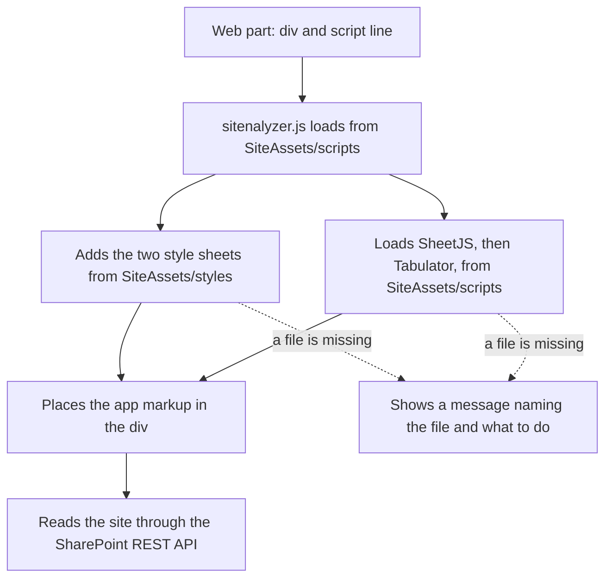

<!--
This file is part of Sitenalyzer
docs/architecture.md
Author(s): Gabriel Mongefranco.
Created: 2026-10-14
Last Modified: 2026-10-21
Summary: How Sitenalyzer's files fit together, how it starts on a SharePoint page, and why it is built this way.
Notes: See README file for documentation and full license information.

Copyright © 2026 The Regents of the University of Michigan

Licensed under the GNU Free Documentation License v1.3 or later.
See <https://www.gnu.org/licenses/fdl-1.3.html>. See README for full license information.

-->

# Sitenalyzer

## Sitenalyzer architecture

[Back to README](../README.md)

This page describes Sitenalyzer's parts, how it starts on a SharePoint page, and why it is built this way. It is for developers and maintainers. Sitenalyzer runs entirely in the browser of the person using it. It reads site information through the SharePoint REST API with that person's own permissions, and it has no server of its own.

### Separate files for the page and the app

SharePoint Online enforces a Content Security Policy (CSP). CSP is a browser rule that decides which scripts a page may run. Under it, SharePoint blocks code written directly into a page, including code pasted into a Modern Script Editor web part. It also blocks scripts from content delivery networks unless a tenant administrator trusts them. Scripts stored in the tenant's own SharePoint sites are allowed.

So the web part holds only an empty `
` and one `<script src>` line. Everything else, including copies of the two libraries, is stored in the site's Site Assets library.

### Parts

| Part | File in SharePoint | Source in this repository |
| --- | --- | --- |
| Page code | Pasted into the Modern Script Editor web part | `src/sitenalyzer.html.txt` |
| App and startup code | `SiteAssets/scripts/sitenalyzer.js` | `src/sitenalyzer.js` plus `src/sitenalyzer.html` |
| App styles | `SiteAssets/styles/sitenalyzer.css` | `src/sitenalyzer.css` |
| SheetJS 0.20.3 | `SiteAssets/scripts/xlsx.full.min.js` | `src/lib/xlsx.full.min.js` |
| Tabulator 6.6.1 | `SiteAssets/scripts/tabulator.min.js` and `SiteAssets/styles/tabulator_simple.min.css` | `src/lib/` |

The build scripts turn `src/` into `dist/`, which has the same folder layout as SharePoint. See [Building and testing Sitenalyzer](development.md).

### Startup

The diagram shows these steps:

1. The page loads, and the Modern Script Editor runs the `<script src>` line. The browser downloads `sitenalyzer.js` from `SiteAssets/scripts`. All of its code is inside one function, so none of its names can clash with other scripts on the page.
2. `sitenalyzer.js` works out which folder it came from. It uses the script's own address, and if that isn't available, the site address in `_spPageContextInfo` plus `/SiteAssets/scripts/`. The styles folder is `../styles/` from there.
3. It adds `tabulator_simple.min.css` and `sitenalyzer.css` to the page. The address of every style sheet and library it loads ends in `?v=` and a version, such as `sitenalyzer.css?v=e2a31408880e`. The build sets the version in `SNA_ASSET_VERSION`, so a browser never pairs a new `sitenalyzer.js` with an older copy of a style sheet that it saved earlier. The Modern Script Editor already adds its own value to the address of `sitenalyzer.js`.
4. At the same time, it loads `xlsx.full.min.js` and then `tabulator.min.js`. While each one loads, it hides the page's module loaders (`define.amd`, `exports`, and `module`) and then puts them back. Other scripts on a SharePoint page can create these names, and when they exist the libraries fill them in instead of the `XLSX` and `Tabulator` globals that the app uses. The Modern Script Editor hides `define.amd` for the same reason, but it puts `define.amd` back as soon as `sitenalyzer.js` has run, which is before the libraries arrive. So Sitenalyzer keeps `define.amd` hidden until each library has loaded, saves any value assigned in the meantime, and then puts back the most recent one. Some pages have an `exports` or `module` object that can't be hidden, such as a read-only one. The library then loads into that object, so after each library loads, Sitenalyzer looks for the working copy in its global, in `exports`, and in `module.exports`. It keeps its own reference to each library instead of reading `window.XLSX` and `window.Tabulator`. A library counts as working only if it passes a check, such as having `XLSX.utils`; if neither place has a working copy, Sitenalyzer shows a message. A library that is already on the page is used only if it passes the same check.
5. When every file has loaded, it places the app markup in `
` and starts the app. SharePoint sometimes adds the web part's `
` to the page a little later, so Sitenalyzer checks for it every 100 milliseconds for up to 10 seconds. If the `
` never appears, it writes an error in the browser console. Both times are set at the top of `src/sitenalyzer.js` (`SNA_MOUNT_WAIT_MS` and `SNA_MOUNT_CHECK_INTERVAL_MS`).
6. If any file fails to load, it shows a message in the `
` that names the file and tells the person which folder to copy it to.

### Requests to SharePoint

Every request is a read made with the signed-in person's own permissions. The only writes are the description edits that site owners make on purpose. The `$batch` requests for shared item names are sent as POST requests, but they hold only reads and change nothing on the site.

| Request | Reason |
| --- | --- |
| `/_api/web`, `/_api/web/currentUser` | Site name, address, and ID; who is exporting. |
| `/_api/web/effectivebasePermissions` | Whether the person can manage the site (the ManageWeb permission). Only then are the description edit buttons shown. |
| `/_api/web/roleassignments`, `/_api/web/lists(guid'…')/roleassignments` | Who has which permission level on the site, and on each list or library that has its own permissions. |
| `/_api/web/lists` | Lists and libraries, with version history settings and last-changed dates for the cleanup suggestions. The request also asks for the User Information List and Events, which Sitenalyzer counts as system lists, apart from the other lists and libraries. `SNA_SYSTEM_LISTS` matches them by list template: 112 for the User Information List, and 106, the events template, for the list titled Events. A list made from another template and named Events stays an ordinary list. |
| `/_api/web/sitegroups(<ID>)/users` | Members of each SharePoint group in the permission list. |
| `/_api/web/sitegroups` | Sharing links, read from the hidden `SharingLinks.*` groups. |
| `/_api/contextinfo` and `/_api/$batch`, holding `GetFileById('…')` and then `GetFolderById('…')` | The names and addresses of up to 60 shared files and folders. See [Shared item names](#shared-item-names). |
| `/_api/web/roledefinitions`, `/_api/web/siteusers?$filter=IsSiteAdmin eq true` | Permission levels and site collection administrators, for the permissions workbook. |
| `/_api/web/lists?$filter=BaseTemplate eq 119` and its `items` | The Site Pages library and its pages. |
| `/_api/web/lists(guid'...')/items(<ID>)?$select=BannerImageUrl` | The image chosen for one site page, read only when its details open. |
| `/_api/web/siteusers?$filter=Email eq '…'` and `getUserEffectivePermissions(@u)` | Only when someone uses **Check a person's access**. |
| Fields, root folders, and the term store (`/_api/v2.1/sites/…/termStore`) | Columns, top-level folders, and terms for the data dictionary. |
| `…/termStore/sets/<ID>/terms?$expand=children`, and `…/terms/<ID>/children` when needed | Which term each term sits under. See [Parent terms and term set use](#parent-terms-and-term-set-use). |
| `/_api/web/lists(guid'…')/fields` and `/_api/web/fields`, each filtered to managed metadata columns, with `SchemaXml` | Which columns use each term set. A list sends this request only when it has a managed metadata column. |

Group member lookups and person checks run at most 6 at a time (`SNA_MAX_PARALLEL_REQUESTS`), so large sites aren't slowed down by SharePoint's request limits.

#### Shared item names

SharePoint names each sharing link group `SharingLinks.<item ID>.<link type>.<link ID>`. The shared item can be a file, a folder, a list item, or a file someone deleted after sharing it. Sitenalyzer looks up the names this way:

1. It gets a request digest from `/_api/contextinfo`, because SharePoint accepts a `$batch` request only with one.
2. It sends `GetFileById('<item ID>')?$select=Name,ServerRelativeUrl` for each item in `$batch` requests, up to 20 lookups in each (`SNA_SHARING_LINK_BATCH_SIZE`) and 60 in all (`SNA_SHARING_LINK_NAME_LOOKUPS`). A batch is one `multipart/mixed` request that holds several GET requests, and SharePoint answers it with one status for each.
3. It sends `GetFolderById` in the same way for the items SharePoint answered 404 Not Found for, so links to folders show the folder's name with "(folder)".
4. Items that still aren't found, such as list items and deleted files, are shown with "No name found" and their ID.

Because SharePoint answers the batch itself with 200 OK, the browser console shows no failed request for items that aren't files. The answer is read by `snaParseBatchResponse`, which accepts CRLF and LF line endings. SharePoint can answer a batch with 200 OK and still throttle single lookups inside it with 429 Too Many Requests. Sitenalyzer sends those lookups again in a batch of their own, after the wait in their `Retry-After` header (at least 2 seconds), up to 5 times. If the digest or a batch fails, the links that haven't been named yet are shown without names. A batch holds only GET requests to the site's own REST API, and `snaBatchGet` refuses any other address.

### Parent terms and term set use

The terms request for a term set doesn't say which term is the parent of which, so Sitenalyzer reads parents after every term set has been read. For each term set, it does these steps:

1. It reads the terms again with `$expand=children`. If every term comes back with a list of its children, that is enough to know each term's parents.
2. If SharePoint rejects that request or leaves out the children, it asks for each term's children with `…/terms/<ID>/children`, at most 6 at a time and at most 1,000 times in each report (`SNA_TERM_CHILD_LOOKUPS`). Children are added in the order the terms were asked for, so the result is the same every time.
3. A term found only as a child is added to the term set, and its children are read too. This covers a term store whose terms request lists only top-level terms.

A term can sit under more than one term, such as a term pinned in two places, so each term keeps a list of parent IDs. The terms are then put in tree order. Every term request follows SharePoint's next-batch link (`@odata.nextLink`) only when it points to the same site's REST API, and stops at 10,000 terms in a term set (`SNA_TERMS_PER_SET_MAX`). If parents can't be read for a term set, Taxonomy leaves out its **Parent term** column and says why. A read that stops at a next-batch link to another site, with `$expand=children` or for one term's children, counts as read in part, so the term set says that a term shown as **Top level** may sit under another term, and **Report coverage** says **Partly read**.

The term set of a managed metadata column isn't returned by the columns request. So a list with a managed metadata column sends one more request for those columns, with `SchemaXml`, the column's definition in XML. Sitenalyzer reads `TermSetId` and `AnchorId` (the term a column starts at) from it with `DOMParser`, and keeps them only when they look like a GUID. The site's own columns are read the same way from `/_api/web/fields`. A site column added to a list has the same column ID in the list, so it is shown once, as the list's column. In the data dictionary, a managed metadata column's `value_set_id` names its term set's value set.

### Permission rows

Sitenalyzer keeps one permission row for each scope, person or group, and permission level. A scope is the whole site or one list or library that has its own permissions. The **People and groups** part of Permissions and the Permissions sheet of the workbook are both built from these rows, so they always agree.

- A permission level on the whole site also covers every list and library that uses the site's permissions. Sitenalyzer says so next to each person or group.
- Limited Access is the exception. SharePoint adds it by itself when someone shares a single item, and it gives no access to other lists. Sitenalyzer recognizes it by its `RoleTypeKind` of 1, or by the level being hidden, so it works on sites in any language. It is never counted as access to the site's lists.
- Groups named `SharingLinks.*` and the Limited Access System Group are created by SharePoint. They are counted and left out of the access list, and the sharing links section lists the links.
- Apps added through SharePoint have the user type, so Sitenalyzer recognizes them by `|ms.sp.ext|` in the sign-in name. Type 4 means a security or Microsoft 365 group, not an app.

### Values from SharePoint are treated as untrusted

- Every name, title, and address from SharePoint is escaped before it is added to the page, so HTML in a list or group name shows as plain text.
- The person check doubles single quotes in the email address before it goes into `$filter` and `@u`, and accepts at most 320 characters with no control characters.
- Item IDs from sharing link group names must look like a GUID before Sitenalyzer asks for the file or folder.
- Sitenalyzer reads the site groups 5,000 at a time (`SNA_SHARING_GROUPS_BATCH_SIZE`) with `$top` and `$skip`, up to 50,000 groups (`SNA_SHARING_GROUPS_MAX`). If it stops early, because it reached that limit or a later request failed, the sharing links section, the guest finding, and Report coverage say that some sharing links may be missing, instead of saying there are none.
- Sitenalyzer follows the Site Pages next-batch link (`odata.nextLink`) only when it points to the same site's REST API. It stops after 10,000 items (`SNA_SITE_PAGES_MAX`) and doesn't sort on the server, because SharePoint rejects sorted requests on libraries with more than 5,000 items.
- Links to shared files and to pages are shown only when they are on the same site.
- The site logo is shown, and the **Open** and **Permissions** buttons open a new window, only for `https://` addresses on the SharePoint tenant being read. Addresses within the site, such as `/sites/example/SiteAssets/logo.png`, are completed with the site's host first.
- Every cell in the permissions workbook is written as text, so a name such as `=SUM(A1)` can't run as a formula.

### Report screen

The report screen has two halves: collecting the report, and drawing views from it.

1. `collectReport` reads the whole site once, in the same order of requests as earlier versions, and returns one report object. It holds the site's identity, the time it was collected (in UTC), every list and library with its columns, folders, and permissions, the site pages, the term store, every permission, and a coverage list that says which parts could not be read. The report shares its arrays and objects with the globals that `exportToXLSX` and `exportPermissionsToXLSX` read, so the workbook builders did not change.
2. `renderApp` draws one view at a time inside `
`. Each section, such as Contents or Permissions, has a render function that builds its markup from the report, with every SharePoint value escaped.
3. Every table on screen is a Tabulator table, built only for the view on screen and destroyed when the view closes. A render function queues each table with `_snaTablesQueue`, through `snaQueueTableHtml`, and `initSnaTabulators` builds the queued tables once the view's markup is on the page. `snaTableColumnSettings` holds the columns of each kind of table. Each filter box's text is kept, so it is still there when the view opens again. The person check keeps its rows in `_snaUserCheckResult`, not finished markup, so `snaRenderUserCheckResult` builds its table again whenever the check finishes or Permissions opens.
   - Tables grow with their rows, so the frame and headings stay in view. Tables with more than 50 rows (`SNA_TABLE_PAGE_ROWS`) use Tabulator's paging, with the page sizes in `SNA_TABLE_PAGE_SIZES` and the names of the paging buttons in `SNA_TABLE_TEXT`. `snaUpdatePagedTableCount` writes the row count of a paged table, and a new filter goes back to the first page.
   - The paging controls and the box that scrolls a table sideways are outside the element with the grid role, because that role allows only rows inside it. `snaFitTableWidth` makes a table as wide as its columns when they don't fit, and makes the box around it a focusable, labeled region only while it scrolls. Tabulator's own scroll area inside the grid is never focusable.
   - People and groups is a set of cards, not a table. Its **Filter by name** and **Sort by** boxes reorder and hide the cards with `snaSortPeopleBlocks` and `snaApplyPeopleFilter`, and keep their choices in `_snaPeopleFilter` and `_snaPeopleSort`. The boxes are added by `snaRenderPermissionPart`, not by `renderPermissionsByPrincipal`, which the print document uses too.
4. Every description is drawn by `renderAdminDescWrap`. While someone edits one, its text is kept in `_snaDrafts` under the same key `snaSaveDescription` takes, such as `list:<list ID>`, and every view draws the editor from there. So a draft stays when the person opens another view, turns on technical details, or sorts a table. Descriptions inside Tabulator tables are drawn by the table's formatter, so the table redraws the row when the editor opens or closes. When a description is saved, `snaApplyDescriptionToReport` writes the new text into the report and into the globals, so views drawn later, search, and both workbooks use it. **Refresh report**, **Start over**, and opening another site ask before discarding an unsaved draft, and the browser asks before the page closes. While a save is running, those actions stop and ask the person to try again, because SharePoint may still make a change that was already sent. The print document is built from the report, which holds only saved descriptions, so a printout never includes a draft.
5. The search index is built from the report as soon as collection finishes, so search covers sections that haven't been opened.
6. Printing builds a separate print document from the report with `snaBuildPrintDocument`: headings, text, and plain HTML tables, with every value escaped. The renderers that draw both a screen table and a printed table take a `forPrint` argument, which draws the plain table instead of queueing a Tabulator table. **Print full report / PDF** and Ctrl+P put the document in a hidden frame, `#sna-print-frame`, with Sitenalyzer's style sheet, and print only that frame. Nothing on the SharePoint page changes, so the page's own scripts can't react to the printout, and focus returns to where it was. The frame is removed by the next printout or a new report. The browser's print menu prints the page itself, so a `beforeprint` listener adds the same document to the end of the page as `#sna-print-root` and gives the page the class `sna-printing`. The print style sheet then hides everything else on the page, including the SharePoint page around the app, and an `afterprint` listener removes the document. On screen the document is never shown.
7. Tabulator column headings can't be reached with the keyboard, so `snaMakeHeadingsSortableByKeyboard` puts each sortable heading in the Tab order and sorts with Enter or Space. Tabulator keeps the headings visible at every width and shows the order with `aria-sort`, so narrow screens need no separate sort control.

A collection is tied to a number that changes when another collection starts or the report is cleared. A collection or person check whose number no longer matches stops and drops its results, so an older site can never appear in a newer report.

#### Report addresses

Each view has an address after `#sna/` in the page address. Sitenalyzer reads and checks every address before it uses it.

| Address | View |
| --- | --- |
| `#sna/overview` | Overview |
| `#sna/contents` | Contents, with nothing selected |
| `#sna/contents/<list ID>` and `#sna/contents/<list ID>/folders`, `/columns`, or `/permissions` | A list or library, with one of its tabs |
| `#sna/contents/pages` | Site pages |
| `#sna/contents/pages/<page key>` | One site page's details. The key is the page's item ID, such as `#sna/contents/pages/4`, with `-2` and so on added for pages in a second Site Pages library. |
| `#sna/permissions`, and `#sna/permissions/site`, `/people`, `/person`, `/own`, `/sharing`, or `/apps` | Permissions, with one part shown; `#sna/permissions` shows `site` |
| `#sna/taxonomy` and `#sna/review` | Taxonomy and Site review |
| `#sna/taxonomy/<term set ID>` | Taxonomy, with one term set shown |
| `#sna/search?q=<text>` | Search results |

- Sections, tabs, and parts are checked against fixed lists, list and term set IDs must look like a GUID, and a page key must be a number. An address that starts with `#sna/` but doesn't match opens the Overview.
- Addresses that don't start with `#sna/`, such as `#top`, belong to the host page and are ignored.
- Only a `?siteUrl=` link chooses the first view, such as `?siteUrl=...#sna/taxonomy`. Without one, Sitenalyzer removes a report address left in the page address, such as after reloading the page, so a new report opens on the Overview. **Refresh report** keeps the view that was open.
- Moving between views changes the address with `location.hash`, so Back and Forward work, and the `hashchange` listener draws the view. Sitenalyzer never calls `history.pushState`. It uses `history.replaceState` for the first view after collection and to remove the address on **Start over**, so neither adds a history step.
- `SNA_ROUTE_MODE` at the top of `src/sitenalyzer.js` is `'hash'`. This was checked on a SharePoint page with the Modern Script Editor web part and `?csp=enforce`. If a page rewrites the address right after Sitenalyzer sets it, Sitenalyzer writes a warning in the console and keeps views in memory for the rest of the visit. Back and Forward then don't change views on that page.
- After every view change, focus moves to the view's heading, the heading of the part or term set in the address, the selected tab or part link, or the item that was open, so keyboard and screen reader users keep their place.
- When the section changes, the page scrolls to the section links (`.sna-nav-row`), so the site's name and details above them show only when the report first opens or is refreshed. Each view is at least as tall as the window, so a short view, such as Taxonomy with one term group, can scroll that far too. SharePoint shows its page bar, with **Edit**, again when the page scrolls up, and the bar then covers the top of the page. So after scrolling, `snaUncoverNavRow` checks what is at the top of the section links. When a fixed or sticky element of the host page covers them, Sitenalyzer scrolls up by the height it covers, once right away and again after `SNA_HOST_BAR_DELAY_MS`, because the bar can appear a moment later. **Back to top** scrolls to the same place and puts focus on the open section's link, or on the first section link from Search results. It sits on the left, because SharePoint can place a Copilot button over the bottom right of the page.

### App markup

The app markup is kept in `src/sitenalyzer.html` so it is easy to edit. It holds the start screen, the frame of the report screen (the site header, section navigation, search, report actions, technical details switch, and footer), and the **Choose a site** dialog. It holds no site data. The build turns each line into a JavaScript string and puts the strings in `sitenalyzer.js`, replacing the line `var SNA_APP_HTML = [];`. This way the site owner uploads one app file, and the page code never changes when the markup does.

### Hidden values

Sitenalyzer hides values that look like personal information unless **Show hidden values** is on. `SNA_HIDDEN_VALUE_PATTERNS` near the top of `src/sitenalyzer.js` lists the patterns, which are adapted from the sharing checks in agentprise and the PHI checks in extractium. None of them uses lookbehind, because a pattern the browser can't read would stop the whole file from loading.

- `snaMaskText` replaces each match in a piece of text with a label, such as `[phone number hidden]`. It skips GUIDs inside the text.
- `snaMaskHtml` hides values in markup that Sitenalyzer has already built and escaped. It changes the text between tags and the `aria-label`, `title`, `alt`, `data-name`, and `data-filter-text` attributes. It keeps `<textarea>` text, which is a description being edited, elements with the class `list-id-text` or `sna-code`, which show IDs and internal names, and elements with the class `sna-person`. `snaPersonHtml` draws people's and groups' names, emails, and sign-in names in that class wherever the report shows who has access. The same value in other text, such as a coordinator's email in a list description, is hidden like any other. Every other attribute, such as `href` and `data-sna-orig` (a description's saved text, for its editor), is kept.
- Every view, the site header, the person check result, the description redraw, the page image area, the site list, and the print document go through `snaMaskHtml` just before they are placed in the page. Every Tabulator column is wrapped by `snaTableColumns`, so table cells go through it too.
- The table filters, the Contents name filter, search, and **Find a site** compare text as it is shown, so typing a hidden value finds nothing. Columns that show people's and groups' names, listed in `SNA_TABLE_PERSON_FIELDS`, and the People and groups name filter compare those names as they are, because the names are shown. The names that `initSnaTabulators` gives tables for screen readers are hidden separately, except a person check's name, such as "Access for" and the person's name. Search also compares a site page's file name as it is shown. The boxes themselves show text as it was typed, so when the switch is turned off, `snaClearTypedHiddenValues` clears any filter or search text that shows a hidden value or part of one, such as `555-0100`. A search for such text is replaced with an empty search, so the page address no longer holds it either. Text counts as showing a hidden value when it matches one of the patterns, when it or one of its words with a digit or @ is part of a hidden value, or when one of its numbers has 4 digits in a row (`SNA_HIDDEN_SEARCH_MIN_DIGITS`) that also appear in a hidden value. Sitenalyzer compares only the digits of each number, without the spaces and punctuation between them, so when `(734) 555-0100` is hidden, `555.0100`, `555 0100`, and `5550100` count too. A letter ends a number. GUIDs, such as a list's ID, are left out, as they are when values are hidden. `snaTypedTextShowsHiddenValue` makes these checks. `snaRouteWithoutHiddenSearch` does the same for a search made while the switch is off. `snaNavigate` uses it before it changes the address, and `renderApp` uses it for an address from a link, Back, or Forward, and replaces that address with `history.replaceState`. So neither the page address nor the browser's history holds the value, and the results page says why it searched for nothing.
- The workbooks hide values in their free-text columns only: the site's name and description, list titles and descriptions, column titles, descriptions, choices, default values, and formulas, and term names and descriptions. The download file names hide them too. The **About** and **Export_Info** sheets say whether values were hidden.
- The report itself always holds the real text. So a description editor opens with it, and a save never writes a hidden-value label over a description.

The switch is never saved, so each visit starts with values hidden. It appears only when there is something to show: a value that `snaCountHiddenValues` finds in the report's names and descriptions, including permission levels, or any other value `snaMaskText` hid while it drew a view or saved a workbook. `snaNoteHiddenValue` records each hidden value and updates the switch once the drawing finishes, and its tooltip (`#sna-hidden-values-tip`, also its accessible description) says how many. `snaSetShowHiddenValues` redraws the site header and the view and returns focus to the switch. Descriptions being edited are kept because they are drawn from `_snaDrafts`. Hiding values by pattern finds only the shapes of text in the patterns, so it doesn't de-identify a report.

### Browser storage

Sitenalyzer saves two things in the browser's local storage. Neither holds any report data. **Show hidden values** is never saved.

| Key | Contents |
| --- | --- |
| `sitenalyzer:sites-cache` | The list of sites the person can open, so the **Site address** list appears quickly next time. It is kept for up to 30 days. The **Refresh sites list** button next to the box clears it. It holds site names as SharePoint gives them, even names that Sitenalyzer hides on screen. |
| `sitenalyzer:technical-details` | `1` while **Show technical details** is on. Sitenalyzer writes it only when someone turns the switch on, and removes it when they turn it off. |

Other apps on the same SharePoint host share that storage, so every Sitenalyzer key starts with `sitenalyzer:`. When the browser blocks storage, both settings last only until the page closes. Sitenalyzer does not use IndexedDB or session storage.

### Rules that keep Sitenalyzer working under CSP

- All code lives in `.js` files in Site Assets. The markup has no `<script>` blocks.
- Event handlers are attached with `addEventListener`, never with attributes such as `onclick="..."`.
- There are no `javascript:` links and no `document.write`.
- Libraries are loaded from Site Assets, never from a content delivery network.

CI checks the source for these patterns, and the browser tests run the app on a test page that blocks inline scripts. See [Building and testing Sitenalyzer](development.md).

### Conclusion

You now know which files make up Sitenalyzer, how they reach SharePoint, how the app starts, what it asks SharePoint, how it counts permissions, and how the report screen draws its views. To change the app, edit `src/` and run a build script.

### Additional resources

- [Building and testing Sitenalyzer](development.md)
- [Installing and using Sitenalyzer](usage.md)
- [Support for Content Security Policy (CSP) in SharePoint Online](https://learn.microsoft.com/en-us/sharepoint/dev/spfx/content-securty-policy-trusted-script-sources)
- [Modern Script Editor web part source code](https://github.com/pnp/sp-dev-fx-webparts/tree/main/samples/react-script-editor)
- [SharePoint REST service](https://learn.microsoft.com/en-us/sharepoint/dev/sp-add-ins/get-to-know-the-sharepoint-rest-service)
- [Permission levels in SharePoint](https://learn.microsoft.com/en-us/sharepoint/understanding-permission-levels)

[Back to README](../README.md)
