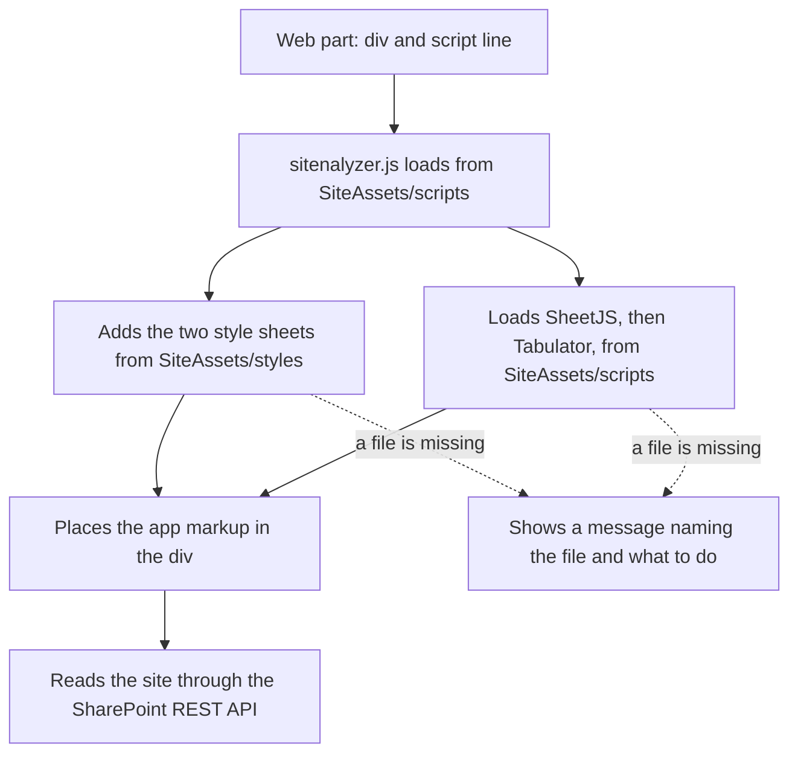

<!--
This file is part of Sitenalyzer
docs/architecture.md
Author(s): Gabriel Mongefranco.
Created: 2026-10-14
Last Modified: 2026-10-14
Summary: How Sitenalyzer's files fit together, how it starts on a SharePoint page, and why it is built this way.
Notes: See README file for documentation and full license information.

Copyright © 2026 The Regents of the University of Michigan

Licensed under the GNU Free Documentation License v1.3 or later.
See <https://www.gnu.org/licenses/fdl-1.3.html>. See README for full license information.

-->

# Sitenalyzer

## How Sitenalyzer works

[Back to README](../README.md)

This page describes Sitenalyzer's parts, how it starts on a SharePoint page, and why it is built this way. It is for developers and maintainers. Sitenalyzer runs entirely in the browser of the person using it. It reads site information through the SharePoint REST API with that person's own permissions, and it has no server of its own.

### Why the files are split up

SharePoint Online enforces a Content Security Policy (CSP). CSP is a browser rule that decides which scripts a page may run. Under it, SharePoint blocks code written directly into a page, including code pasted into a Modern Script Editor web part. It also blocks scripts from content delivery networks unless a tenant administrator trusts them. Scripts stored in the tenant's own SharePoint sites are allowed.

So the web part holds only an empty `
` and one `<script src>` line. Everything else, including copies of the two libraries, is stored in the site's Site Assets library.

### Parts

| Part | File in SharePoint | Source in this repository |
| --- | --- | --- |
| Page code | Pasted into the Modern Script Editor web part | `src/sitenalyzer.html.txt` |
| App and startup code | `SiteAssets/scripts/sitenalyzer.js` | `src/sitenalyzer.js` plus `src/sitenalyzer.html` |
| App styles | `SiteAssets/styles/sitenalyzer.css` | `src/sitenalyzer.css` |
| SheetJS 0.20.3 | `SiteAssets/scripts/xlsx.full.min.js` | `src/lib/xlsx.full.min.js` |
| Tabulator 6.6.1 | `SiteAssets/scripts/tabulator.min.js` and `SiteAssets/styles/tabulator_simple.min.css` | `src/lib/` |

The build scripts turn `src/` into `dist/`, which has the same folder layout as SharePoint. See [Building and testing Sitenalyzer](development.md).

### How Sitenalyzer starts

The diagram shows these steps:

1. The page loads, and the Modern Script Editor runs the `<script src>` line. The browser downloads `sitenalyzer.js` from `SiteAssets/scripts`.
2. `sitenalyzer.js` works out which folder it came from. It uses the script's own address, and if that isn't available, the site address in `_spPageContextInfo` plus `/SiteAssets/scripts/`. The styles folder is `../styles/` from there.
3. It adds `tabulator_simple.min.css` and `sitenalyzer.css` to the page.
4. At the same time, it loads `xlsx.full.min.js` and then `tabulator.min.js`. While each one loads, it hides any AMD loader on the page, so the libraries create the `XLSX` and `Tabulator` globals that the app uses. The Modern Script Editor does the same thing for the scripts it loads.
5. When every file has loaded, it places the app markup in `
` and starts the app.
6. If any file fails to load, it shows a message in the `
` that names the file and tells the person which folder to copy it to.

### Where the app markup comes from

The app markup is kept in `src/sitenalyzer.html` so it is easy to edit. The build turns each line into a JavaScript string and puts the strings in `sitenalyzer.js`, replacing the line `var SNA_APP_HTML = [];`. This way the site owner uploads one app file, and the page code never changes when the markup does.

### Browser storage

Sitenalyzer saves one thing in the browser: the list of sites the person can open, so the **Site URL** list appears quickly next time. It keeps this list in the browser's local storage for up to 30 days under the key `sitenalyzer:sites-cache`. The **Refresh sites list** button next to the box clears it. Other apps on the same SharePoint host share that storage, so every Sitenalyzer key starts with `sitenalyzer:`. Sitenalyzer does not use IndexedDB or session storage.

### Rules that keep Sitenalyzer working under CSP

- All code lives in `.js` files in Site Assets. The markup has no `<script>` blocks.
- Event handlers are attached with `addEventListener`, never with attributes such as `onclick="..."`.
- There are no `javascript:` links and no `document.write`.
- Libraries are loaded from Site Assets, never from a content delivery network.

CI checks the source for these patterns, and the browser tests run the app on a test page that blocks inline scripts. See [Building and testing Sitenalyzer](development.md).

### Conclusion

You now know which files make up Sitenalyzer, how they reach SharePoint, and how the app starts. To change the app, edit `src/` and run a build script.

### Additional resources

- [Building and testing Sitenalyzer](development.md)
- [Installing and using Sitenalyzer](usage.md)
- [Support for Content Security Policy (CSP) in SharePoint Online](https://learn.microsoft.com/en-us/sharepoint/dev/spfx/content-securty-policy-trusted-script-sources)
- [Modern Script Editor web part source code](https://github.com/pnp/sp-dev-fx-webparts/tree/main/samples/react-script-editor)
- [SharePoint REST service](https://learn.microsoft.com/en-us/sharepoint/dev/sp-add-ins/get-to-know-the-sharepoint-rest-service)

[Back to README](../README.md)
