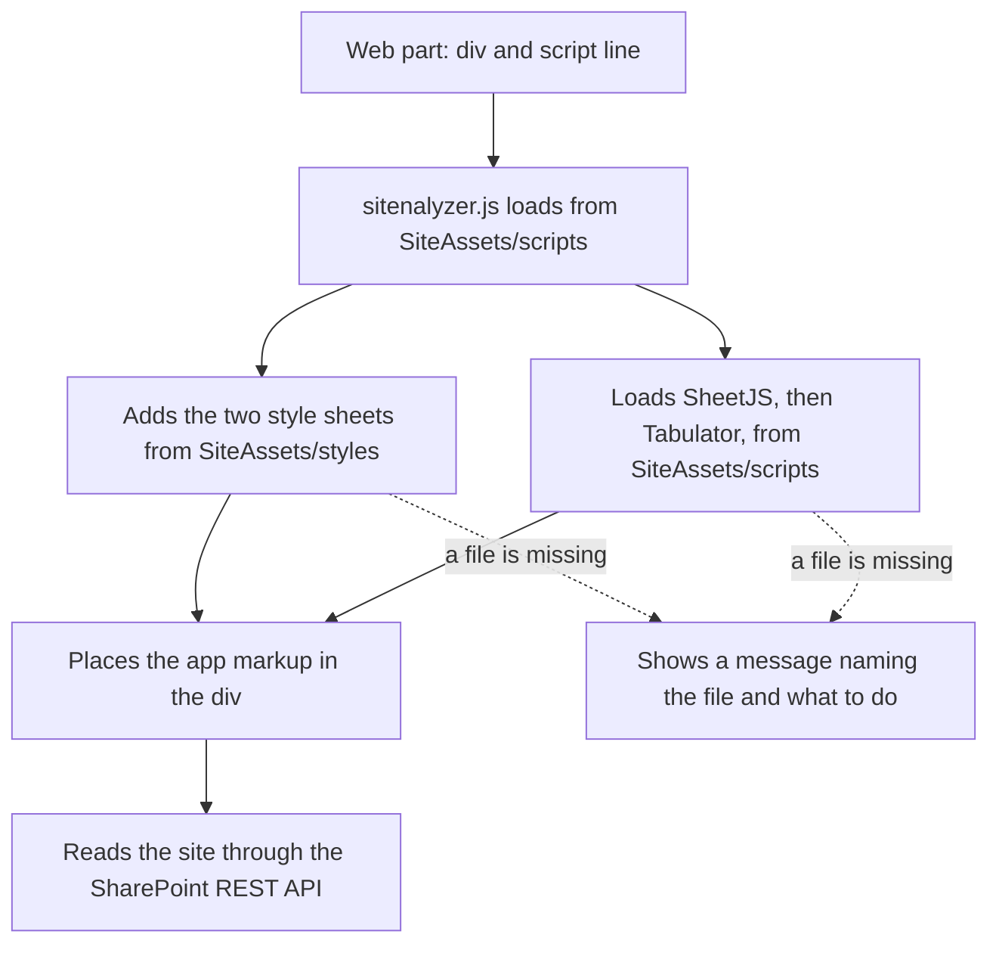

<!--
This file is part of Sitenalyzer
docs/architecture.md
Author(s): Gabriel Mongefranco.
Created: 2026-10-14
Last Modified: 2026-10-19
Summary: How Sitenalyzer's files fit together, how it starts on a SharePoint page, and why it is built this way.
Notes: See README file for documentation and full license information.

Copyright © 2026 The Regents of the University of Michigan

Licensed under the GNU Free Documentation License v1.3 or later.
See <https://www.gnu.org/licenses/fdl-1.3.html>. See README for full license information.

-->

# Sitenalyzer

## How Sitenalyzer works

[Back to README](../README.md)

This page describes Sitenalyzer's parts, how it starts on a SharePoint page, and why it is built this way. It is for developers and maintainers. Sitenalyzer runs entirely in the browser of the person using it. It reads site information through the SharePoint REST API with that person's own permissions, and it has no server of its own.

### Why the files are split up

SharePoint Online enforces a Content Security Policy (CSP). CSP is a browser rule that decides which scripts a page may run. Under it, SharePoint blocks code written directly into a page, including code pasted into a Modern Script Editor web part. It also blocks scripts from content delivery networks unless a tenant administrator trusts them. Scripts stored in the tenant's own SharePoint sites are allowed.

So the web part holds only an empty `
` and one `<script src>` line. Everything else, including copies of the two libraries, is stored in the site's Site Assets library.

### Parts

| Part | File in SharePoint | Source in this repository |
| --- | --- | --- |
| Page code | Pasted into the Modern Script Editor web part | `src/sitenalyzer.html.txt` |
| App and startup code | `SiteAssets/scripts/sitenalyzer.js` | `src/sitenalyzer.js` plus `src/sitenalyzer.html` |
| App styles | `SiteAssets/styles/sitenalyzer.css` | `src/sitenalyzer.css` |
| SheetJS 0.20.3 | `SiteAssets/scripts/xlsx.full.min.js` | `src/lib/xlsx.full.min.js` |
| Tabulator 6.6.1 | `SiteAssets/scripts/tabulator.min.js` and `SiteAssets/styles/tabulator_simple.min.css` | `src/lib/` |

The build scripts turn `src/` into `dist/`, which has the same folder layout as SharePoint. See [Building and testing Sitenalyzer](development.md).

### How Sitenalyzer starts

The diagram shows these steps:

1. The page loads, and the Modern Script Editor runs the `<script src>` line. The browser downloads `sitenalyzer.js` from `SiteAssets/scripts`. All of its code is inside one function, so none of its names can clash with other scripts on the page.
2. `sitenalyzer.js` works out which folder it came from. It uses the script's own address, and if that isn't available, the site address in `_spPageContextInfo` plus `/SiteAssets/scripts/`. The styles folder is `../styles/` from there.
3. It adds `tabulator_simple.min.css` and `sitenalyzer.css` to the page.
4. At the same time, it loads `xlsx.full.min.js` and then `tabulator.min.js`. While each one loads, it hides the page's module loaders (`define.amd`, `exports`, and `module`) and then puts them back. Other scripts on a SharePoint page can create these names, and when they exist the libraries fill them in instead of the `XLSX` and `Tabulator` globals that the app uses. The Modern Script Editor hides `define.amd` for the same reason, but it puts `define.amd` back as soon as `sitenalyzer.js` has run, which is before the libraries arrive. So Sitenalyzer keeps `define.amd` hidden until each library has loaded, saves any value assigned in the meantime, and then puts back the most recent one. Some pages have an `exports` or `module` object that can't be hidden, such as a read-only one. The library then loads into that object, so after each library loads, Sitenalyzer looks for the working copy in its global, in `exports`, and in `module.exports`. It keeps its own reference to each library instead of reading `window.XLSX` and `window.Tabulator`. A library counts as working only if it passes a check, such as having `XLSX.utils`; if neither place has a working copy, Sitenalyzer shows a message. A library that is already on the page is used only if it passes the same check.
5. When every file has loaded, it places the app markup in `
` and starts the app. SharePoint sometimes adds the web part's `
` to the page a little later, so Sitenalyzer checks for it every 100 milliseconds for up to 10 seconds. If the `
` never appears, it writes an error in the browser console. Both times are set at the top of `src/sitenalyzer.js` (`SNA_MOUNT_WAIT_MS` and `SNA_MOUNT_CHECK_INTERVAL_MS`).
6. If any file fails to load, it shows a message in the `
` that names the file and tells the person which folder to copy it to.

### What Sitenalyzer asks SharePoint

Every request is a read made with the signed-in person's own permissions. The only writes are the description edits that site owners make on purpose.

| Request | Why |
| --- | --- |
| `/_api/web`, `/_api/web/currentUser` | Site name, address, and ID; who is exporting. |
| `/_api/web/effectivebasePermissions` | Whether the person can manage the site (the ManageWeb permission). Only then are the description edit buttons shown. |
| `/_api/web/roleassignments`, `/_api/web/lists(guid'…')/roleassignments` | Who has which permission level on the site, and on each list or library that has its own permissions. |
| `/_api/web/lists` | Lists and libraries, with version history settings and last-changed dates for the cleanup suggestions. |
| `/_api/web/sitegroups(<ID>)/users` | Members of each SharePoint group in the permission list. |
| `/_api/web/sitegroups` and `/_api/web/GetFileById('…')` | Sharing links, read from the hidden `SharingLinks.*` groups, and the names of up to 60 shared files. |
| `/_api/web/roledefinitions`, `/_api/web/siteusers?$filter=IsSiteAdmin eq true` | Permission levels and site collection administrators, for the permissions workbook. |
| `/_api/web/lists?$filter=BaseTemplate eq 119` and its `items` | The Site Pages library and its pages. |
| `/_api/web/siteusers?$filter=Email eq '…'` and `getUserEffectivePermissions(@u)` | Only when someone uses **Check one person's access**. |
| Fields, root folders, and the term store (`/_api/v2.1/sites/…/termStore`) | Columns, top-level folders, and terms for the data dictionary. |

Group member lookups, file name lookups, and person checks run at most 6 at a time (`SNA_MAX_PARALLEL_REQUESTS`), so large sites aren't slowed down by SharePoint's request limits.

### How permissions are counted

Sitenalyzer keeps one permission row for each scope, person or group, and permission level. A scope is the whole site or one list or library that has its own permissions. The **Who has access** section and the Permissions sheet of the workbook are both built from these rows, so they always agree.

- A permission level on the whole site also covers every list and library that uses the site's permissions. Sitenalyzer says so next to each person or group.
- Limited Access is the exception. SharePoint adds it by itself when someone shares a single item, and it gives no access to other lists. Sitenalyzer recognizes it by its `RoleTypeKind` of 1, or by the level being hidden, so it works on sites in any language. It is never counted as access to the site's lists.
- Groups named `SharingLinks.*` and the Limited Access System Group are created by SharePoint. They are counted and left out of the access list, and the sharing links section lists the links.
- Apps added through SharePoint have the user type, so Sitenalyzer recognizes them by `|ms.sp.ext|` in the sign-in name. Type 4 means a security or Microsoft 365 group, not an app.

### Values from SharePoint are treated as untrusted

- Every name, title, and address from SharePoint is escaped before it is added to the page, so HTML in a list or group name shows as plain text.
- The person check doubles single quotes in the email address before it goes into `$filter` and `@u`, and accepts at most 320 characters with no control characters.
- File IDs from sharing link group names must look like a GUID before Sitenalyzer asks for the file.
- Sitenalyzer follows the Site Pages next-batch link (`odata.nextLink`) only when it points to the same site's REST API. It stops after 10,000 items (`SNA_SITE_PAGES_MAX`) and doesn't sort on the server, because SharePoint rejects sorted requests on libraries with more than 5,000 items.
- Links to shared files and to pages are shown only when they are on the same site.
- The site logo is shown, and the **Open** and **Permissions** buttons open a new window, only for `https://` addresses on the SharePoint tenant being read. Addresses within the site, such as `/sites/example/SiteAssets/logo.png`, are completed with the site's host first.
- Every cell in the permissions workbook is written as text, so a name such as `=SUM(A1)` can't run as a formula.

### How the report screen works

The report screen has two halves: collecting the report, and drawing views from it.

1. `collectReport` reads the whole site once, in the same order of requests as earlier versions, and returns one report object. It holds the site's identity, the time it was collected (in UTC), every list and library with its columns, folders, and permissions, the site pages, the term store, every permission, and a coverage list that says which parts could not be read. The report shares its arrays and objects with the globals that `exportToXLSX` and `exportPermissionsToXLSX` read, so the workbook builders did not change.
2. `renderApp` draws one view at a time inside `
`. Each section, such as Contents or Permissions, has a render function that builds its markup from the report, with every SharePoint value escaped.
3. Tabulator tables are built only for the view on screen, and are destroyed when the view closes. Each filter box's text is kept, so it is still there when the view opens again.
4. When a description is saved, `snaApplyDescriptionToReport` writes the new text into the report and into the globals, so views drawn later, search, and both workbooks use it.
5. The search index is built from the report as soon as collection finishes, so search covers sections that haven't been opened.

A collection is tied to a number that changes when another collection starts or the report is cleared. A collection or person check whose number no longer matches stops and drops its results, so an older site can never appear in a newer report.

#### Report addresses

Each view has an address after `#sna/` in the page address. Sitenalyzer reads and checks every address before it uses it.

| Address | View |
| --- | --- |
| `#sna/overview` | Overview |
| `#sna/contents` | Contents, with nothing selected |
| `#sna/contents/<list ID>` and `#sna/contents/<list ID>/folders`, `/columns`, or `/permissions` | A list or library, with one of its tabs |
| `#sna/contents/pages` | Site pages |
| `#sna/permissions`, and `#sna/permissions/site`, `/people`, `/person`, `/own`, `/sharing`, or `/apps` | Permissions, with one part opened |
| `#sna/taxonomy` and `#sna/review` | Taxonomy and Site review |
| `#sna/search?q=<text>` | Search results |
| `#sna/print` | The full report, for printing |

- Sections, tabs, and parts are checked against fixed lists, and list IDs must look like a GUID. An address that starts with `#sna/` but doesn't match opens the Overview.
- Addresses that don't start with `#sna/`, such as `#top`, belong to the host page and are ignored.
- The first report after the page opens uses the view in the address, such as from a `?siteUrl=...#sna/taxonomy` link. Later reports open on the Overview, or on the same view for **Refresh report**, so an address left in the browser history by an earlier site doesn't choose the view.
- Moving between views changes the address with `location.hash`, so Back and Forward work, and the `hashchange` listener draws the view. Sitenalyzer never calls `history.pushState`. It uses `history.replaceState` for the first view after collection and to remove the address on **Start over**, so neither adds a history step.
- `SNA_ROUTE_MODE` at the top of `src/sitenalyzer.js` is `'hash'`. This was checked on a SharePoint page with the Modern Script Editor web part and `?csp=enforce`. If a page rewrites the address right after Sitenalyzer sets it, Sitenalyzer writes a warning in the console and keeps views in memory for the rest of the visit. Back and Forward then don't change views on that page.
- After every view change, focus moves to the view's heading, the selected tab, or the item that was open, so keyboard and screen reader users keep their place.

### Where the app markup comes from

The app markup is kept in `src/sitenalyzer.html` so it is easy to edit. It holds the start screen and the frame of the report screen: the site header, section navigation, search, report actions, technical details switch, and footer. It holds no site data. The build turns each line into a JavaScript string and puts the strings in `sitenalyzer.js`, replacing the line `var SNA_APP_HTML = [];`. This way the site owner uploads one app file, and the page code never changes when the markup does.

### Browser storage

Sitenalyzer saves two things in the browser's local storage. Neither holds any report data.

| Key | What it holds |
| --- | --- |
| `sitenalyzer:sites-cache` | The list of sites the person can open, so the **Site URL** list appears quickly next time. It is kept for up to 30 days. The **Refresh sites list** button next to the box clears it. |
| `sitenalyzer:technical-details` | `1` while **Show technical details** is on. Sitenalyzer writes it only when someone turns the switch on, and removes it when they turn it off. |

Other apps on the same SharePoint host share that storage, so every Sitenalyzer key starts with `sitenalyzer:`. When the browser blocks storage, both settings last only until the page closes. Sitenalyzer does not use IndexedDB or session storage.

### Rules that keep Sitenalyzer working under CSP

- All code lives in `.js` files in Site Assets. The markup has no `<script>` blocks.
- Event handlers are attached with `addEventListener`, never with attributes such as `onclick="..."`.
- There are no `javascript:` links and no `document.write`.
- Libraries are loaded from Site Assets, never from a content delivery network.

CI checks the source for these patterns, and the browser tests run the app on a test page that blocks inline scripts. See [Building and testing Sitenalyzer](development.md).

### Conclusion

You now know which files make up Sitenalyzer, how they reach SharePoint, how the app starts, what it asks SharePoint, how it counts permissions, and how the report screen draws its views. To change the app, edit `src/` and run a build script.

### Additional resources

- [Building and testing Sitenalyzer](development.md)
- [Installing and using Sitenalyzer](usage.md)
- [Support for Content Security Policy (CSP) in SharePoint Online](https://learn.microsoft.com/en-us/sharepoint/dev/spfx/content-securty-policy-trusted-script-sources)
- [Modern Script Editor web part source code](https://github.com/pnp/sp-dev-fx-webparts/tree/main/samples/react-script-editor)
- [SharePoint REST service](https://learn.microsoft.com/en-us/sharepoint/dev/sp-add-ins/get-to-know-the-sharepoint-rest-service)
- [Permission levels in SharePoint](https://learn.microsoft.com/en-us/sharepoint/understanding-permission-levels)

[Back to README](../README.md)
